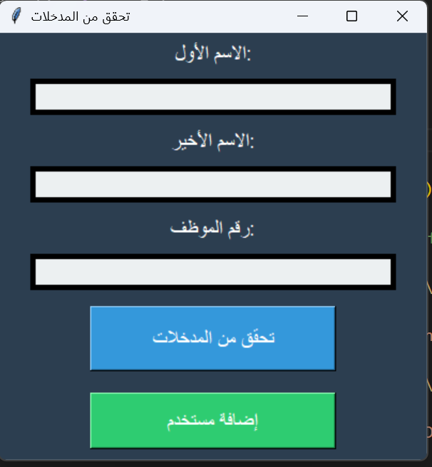

# Employee Input Validation

A simple desktop GUI created with **Python and Tkinter** to collect a first name, last name, and employee ID.

## Features
- Form for entering employee details
- Validation of the first name length and numeric employee ID
- Error and success dialogs
- Separate button that displays an employee-added confirmation

## Technologies
- Python 3
- Tkinter (Python standard library)

## How to Run
Run `python employee_validator.py` using a Python installation with Tkinter support.

## Known Limitations
- The validation button checks whether the last name is empty, but does not yet enforce the assignment's minimum two-character last-name rule.
- The **Add User** button checks only that fields are non-empty; it does not save employee records.

## Screenshot

*Screenshot of the actual Tkinter application.*
